<div align="center">

# GRUDGE™

**A Tamagotchi that lives in your GitHub profile README.**

Your commits are its food. Your CI is its immune system.
Your neglect is its villain origin story.

<br>



<br>

*Zero dependencies. One HTTP server. Seven species. Unlimited emotional damage.*

<br>

[](package.json)
[](test/)
[](package.json)
[](#house-rules)

</div>

---

## What is this

GRUDGE is a virtual pet that feeds on your git activity and holds you accountable in the most public way possible:

- **You push** — it eats. It forgives you. It forgives you *conditionally*.
- **Your build fails** — it is poisoned. It lets everyone know.
- **You go quiet for 3 days** — it opens a passive-aggressive issue. On your repo. Under your name, in the notification feed of everyone watching.
- **Day 7 of silence** — it dies. Publicly. Your README becomes its tombstone, epitaph included.
- **You hatch a new egg** — the next generation inherits the graveyard, and the grudges.

The card above is a live SVG served by your own server and embedded in your profile README. Everyone who visits your GitHub sees exactly how well you are treating it. That is the entire point.

## A death, in four acts

What happens when you stop pushing. All four cards below are real renderer output.

<div align="center">

<br>
<sup><b>Day 1.</b> Fed, shipped, insufferable about it.</sup>

<br><br>

<br>
<sup><b>Day 3.</b> Fullness dropping. Status: <i>sighing loudly</i>. You have seen the sighing. You have done nothing.</sup>

<br><br>

<br>
<sup><b>Day 4.</b> The issue has been filed. It is titled <i>"Are you okay? Asking for me, not for you."</i></sup>

<br><br>

<br>
<sup><b>Day 9.</b> Your profile now displays a tombstone to everyone who visits. Forever. Or until you hatch an heir, who will know what you did.</sup>

</div>

## The issues it files

At 72 hours of silence, on a repo of your choosing:

> **Are you okay? Asking for me, not for you.**
>
> It has been **3 days** since your last commit.
>
> Status report:
> - fullness: 12/100
> - the `.gitignore`: eaten
> - the linter config: next
>
> Push something. Anything. Even a typo fix. *Especially* a typo fix.

At 120 hours, the finale:

> **Estate planning (URGENT)**
>
> Day 5. No commits. I'm putting my affairs in order.
>
> My will:
> - my food bowl → the CI runner that failed me least
> - my grudges → your `TODO` comments (they will outlive us all)
> - my memories of you → `/dev/null`
>
> One commit before day 7 and we can forget this whole thing happened.

## Mechanics

| Event | Effect |
|---|---|
| push (per commit) | +8 fullness, morale up, escalation resets |
| build passes | +5 health |
| build fails | −15 health, poisoned for 6 hours |
| time passing | −2 fullness/hour; at zero, health starts draining |
| well fed (>50) | +1 health/hour regeneration |

The abandonment ladder, measured in hours since your last commit:

| Silence | Stage | Consequence |
|---|---|---|
| 24h | sighing loudly | the status line turns pointed |
| 48h | drafting an issue | you can practically hear it typing |
| 72h | issue no. 1 | *"Are you okay? Asking for me, not for you."* |
| 120h | issue no. 2 | *"Estate planning (URGENT)"* |
| 168h | gone | tombstone, epitaph, permanent graveyard entry |

Three causes of death, each with its own epitaph:

| Cause | Epitaph |
|---|---|
| starvation | *Starved on day N. The commits were "coming tomorrow."* |
| build failures | *Poisoned by a broken build. The tests were red. So were my eyes.* |
| abandonment | *Waited N days by the webhook. You never pushed.* |

## Species and unlocks

Every egg is a dice roll — but only across species you have **earned**. Career progress (streaks, builds, survival records) persists across generations.

| Species | Color | How to earn it | Disposition |
|---|---|---|---|
| commit gremlin | green | starter | born from a merge conflict, raised by spite |
| byte cat | orange | starter | knocks your uncommitted changes off the table |
| merge octopus | teal | starter | eight arms, still not allowed near prod |
| build bot | steel | pass 10 builds | speaks binary when hungry |
| fork bunny | white | commit 3 days in a row | multiplies your branches, you're welcome |
| zen capybara | brown | keep a pet alive for 7 days | unbothered, moisturized, ignoring your CI |
| startup unicorn | pink, gold horn | 10 commits in a single day | mythical, like your test coverage |

<div align="center">
<br>
<br>
<sup>The unicorn. The horn stays gold through every mood, including death. Commitment to the brand.</sup>
<br>
</div>

Thresholds live in `UNLOCKS` in [src/engine.js](src/engine.js) — one line each to tune. Preview any sprite without touching your real pet: `/pet.svg?species=capybara`.

## House rules

The lore is enforced by the state machine, not the honor system:

- **Eggs are a dice roll.** You don't pick the species. You find out when it hatches.
- **The dead keep their names.** Renaming a corpse returns HTTP 400. The graveyard is not up for revision.
- **Corpses ignore food.** No zombie feeding. Necromancy is a different feature.
- **Career survives death.** Unlocks and records pass to the heir. So does the graveyard.
- **The heir remembers.** Its first words reference its predecessor. You did this.

## Quickstart

```bash
node src/server.js
# dashboard    http://localhost:4321
# README card  http://localhost:4321/pet.svg
```

No install step. No dependencies. Node 18+.

Out of the box it runs in **demo mode**: the dashboard is a full Tamagotchi device — LCD screen, FEED / SHIP / BREAK buttons, a +12h time-warp lever — and every button fires the exact same internal event as a real GitHub webhook. Warp time forward and watch it spiral. Name your pet in the NAME TAG box (16 characters; see house rules regarding the dead).

## Real mode

Copy `.env.example` to `.env`. Two ways in, use either or both:

1. **Polling (no deploy needed).** Set `GITHUB_USERNAME` (plus `GITHUB_TOKEN` for private events). The server polls your GitHub activity every 90 seconds; your actual pushes feed the pet. First pushes to brand-new repos count too — GitHub logs those as branch-creation events rather than pushes, and the poller knows the difference between that and a feature branch.
2. **Webhooks.** Deploy anywhere, point a repo or org webhook at `POST /webhook` with events `push` and `workflow_run`, set `WEBHOOK_SECRET` on both ends. Signatures are verified (HMAC SHA-256).

To let it **actually file issues**, set `GITHUB_TOKEN` (needs issues write) and `GITHUB_ISSUE_REPO=you/some-repo`. Without those, issues are logged, not posted — the pet drafts them either way.

Then embed the card in your profile README:

```md

```

## Architecture

```
GitHub (webhooks / polled events)          simulator buttons
              └──────────────┬──────────────────┘
                             ▼
                   engine.js  — pure state machine, lazy time decay,
                                escalation ladder, returns side-effects
                             ▼
                   server.js  — node:http, SSE live updates, effect
                                handler (logs issues in demo, files in real)
                     ▼                    ▼
              pet.svg (dynamic       dashboard (Tamagotchi
              README card, CSS-      device, LCD screen,
              animated pixel art)    event log, graveyard)
```

Design decisions worth stealing:

- **Zero runtime dependencies.** `node:http`, `node:crypto`, `node:fs`. Nothing to install, nothing to audit, nothing to break.
- **Lazy decay.** No cron. Elapsed time is applied whenever state is touched, so the pet starves correctly even if the server was down for two days — it wakes up appropriately furious. A 60-second heartbeat exists only so escalations fire while nobody is watching.
- **Engine purity.** `engine.js` does no I/O and never calls `Date.now()` — callers pass `now`. That one constraint is what makes the time-warp button, the poll backfill, and the entire test suite trivial.
- **One code path.** Simulator buttons, webhooks, and polling all produce identical internal events. If it works in demo, it works in production, because it *is* production.
- **Faces are stamps, not sprites.** Mood expressions are coordinate overlays applied to any body grid, so all six moods work on every species automatically. A new species costs about fifteen lines.
- **The README card is the database.** The SVG endpoint renders directly from live state — there is no cache to invalidate and no way for the card to lie.

## Tests

```bash
npm test
```

27 tests covering the decay math, the exactly-once issue escalation, death by all three causes, generational inheritance, unlock conditions (including the edge cases: commits spread across days don't count as one day, a skipped day resets the streak), rename rules for the living and the dead, GitHub event translation, and webhook signature verification.

## Roadmap

- [ ] Proper GitHub App (per-user installs, no PAT)
- [ ] Hosted multi-tenant mode — every dev gets a pet, every pet gets a grudge
- [ ] Rare variants and streak accessories
- [ ] Flaky tests give it anxiety

---

<div align="center">

*It is not mad. It is drafting an issue.*

</div>
